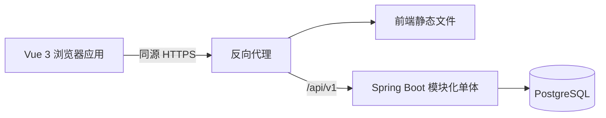

# 总体架构

## 技术选型

| 层 | 选型 | 用途 |
| --- | --- | --- |
| Web | Vue 3、TypeScript、Vite、Vue Router、Pinia | 路由、训练组件、会话内状态与请求失败恢复 |
| API | Java 21、Spring Boot 4.x、Spring MVC、Security、Validation、Spring Data JPA、Maven Wrapper | 请求校验、同源会话鉴权、业务与持久化 |
| 数据 | PostgreSQL、Flyway、Spring Session JDBC | 课程与作答数据、数据库迁移和服务端会话 |
| 验证 | Vitest、Playwright、JUnit 5、Spring Boot Test、Testcontainers | 输入行为、端到端流程、判分与数据库约束验证 |
| 运行 | Docker Compose 本地数据库，生产反向代理 + Spring Boot + PostgreSQL | 本地联调、同源 HTTPS 与发布 |

版本是设计基线。建仓时锁定仍受维护的兼容补丁版本并提交前端锁文件。后端用模块化单体，P0 使用一个 PostgreSQL 实例。开发环境通过 Vite 代理转发 `/api`，生产由反向代理在同一域名下托管前端和转发 API。[Spring Boot 官方项目页](https://spring.io/projects/spring-boot/)



## 工程结构与职责

```text
frontend/src/
  features/{catalog,practice,assessment,personalization,account,progress,review}
  router/
  shared/api/
backend/src/main/java/.../
  catalog/
  practice/
  assessment/
  personalization/
  account/
  progress/
  review/
  shared/
backend/src/main/resources/db/migration/
docs/
```

- `catalog` 提供已发布题库和不可变版本查询。完整答案只在服务端判分、提示和反馈路径读取。
- `account` 提供当前学习者身份 `learnerId`。访客和账号共享同一业务身份模型。
- `assessment` 管理词汇测评题集、会话、评分和历史结果，输出带版本的词汇档和质量信号。
- `personalization` 管理考试目标和各目标难度。它读取词汇档、可发布题库和练习事实，并调用 `practice` 创建定制批次。测评和选题均在应用内处理。
- `practice` 管理课程、定制与错题场景的会话、作答事实、提示和流转。模块向调用方提供终结事实，课程进度和定制调档分别消费相应场景。
- `progress` 归并课程练习事实并提供进度读取。P0 的聚合与会话终结在同一数据库事务。
- `review` P2 加入，消费已提交事实并调用练习模块创建复习会话。复习采用独立场景，课程进度查询只统计课程场景。

## API 与一致性约定

- 同源 JSON REST API 放在 `/api/v1`。以下各模块表格省略此前缀。标识符作为字符串传输，时间用 UTC ISO 8601，客户端本地化显示。时间字段数据库用 `timestamptz`。
- 错误使用 Problem Details，带 `code` 与 `requestId`。典型状态为 400 格式错误、401 会话缺失、403 CSRF 或权限不足、404 资源不存在或不归当前学习者、409 状态或幂等冲突、422 合法格式但违反输入规则、429 限流。
- 练习、测评与定制相关写操作带客户端生成的 UUID 请求号。后端锁定并校验当前学习者身份，再校验资源归属、锁定对应会话或设置行、检查已提交的请求记录，最后处理状态推进。按相同请求号和相同请求内容重试时返回原结果。相同请求号配不同内容返回 409。不同请求号碰到过期修订号或题目返回 409 并由前端重新拉取状态。
- PostgreSQL 用外键、唯一约束和检查约束兜住应用规则。业务状态更新和同模块派生数据同事务提交。涉及跨学习者迁移时按身份 ID 顺序锁定身份行。聚合和派生数据应可按作答事实重建。
- 私有会话、答案及反馈接口使用 `Cache-Control: no-store`。身份由服务端会话解析。日志记录请求号、耗时、路由与错误码，过滤原始答题内容、登录凭证和会话值。

## 运行与发布

- 本地使用 PostgreSQL 容器，Flyway 迁移在新库可从零执行。示例课程按环境从确定的种子数据导入。
- CI 运行类型检查、单元测试、真实 PostgreSQL 集成测试和端到端冒烟。先验证向后兼容迁移，再部署 API 与 Web，最后运行健康检查、课节和「词汇测试 → 定制批次」冒烟流程。词表、题集、评分算法与选题规则分别版本化，生产升级后可读旧结果。
- 生产记录 HTTP 5xx、判分耗时、连接池、迁移结果和登录异常率。仅对探针暴露健康状态。每天备份数据库并演练恢复。回退应用镜像须与现行数据库结构兼容。
- P0 验收环境基线为 20 名并发学习者时判分请求 P95 小于 300 ms，以服务端计时验证。另验证手机软键盘、键盘可达、端到端超时重试、跨账号访问和数据库恢复。
